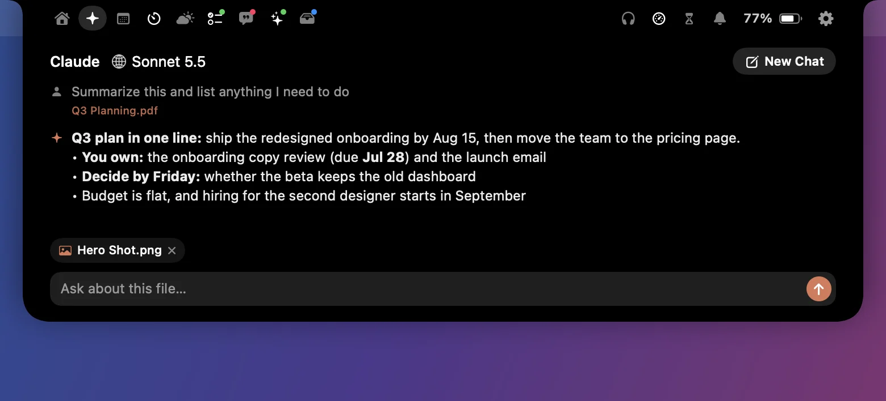

# Notchy

**[Website](https://rishidil.github.io/notchy/) · [Download](https://github.com/rishidil/notchy/releases/latest/download/Notchy.dmg)**



The AI notch for your Mac. A Dynamic Island with **Claude built in**: ask anything from the top of your screen, drop
files on the notch to ask about them, and answer your coding agents' approvals and questions without switching apps.
Native SwiftUI + AppKit, no dependencies, ~0% CPU at idle.

Hover the notch to expand it. When something's happening, the notch grows a **live activity**: Claude thinking or
searching the web, agents at work, now playing, timers, charging, volume/brightness, upcoming meetings and
notification previews.

## Features

| | |
| --- | --- |
| ✳️ **Claude** | Ask Claude from the notch with your own Anthropic account. Streams answers, searches the web (with sources), and reads files you drop on **Ask Claude**: images, PDFs, code and text, even folders. Live activity while it works, a pop-up when the answer's ready |
| ✨ **Agents (T3 Code)** | See, prompt and start your [T3 Code](https://t3.codes) agents, and **approve actions or answer their questions right in the notch**. Live activity while they work, alerts when one finishes or needs you |
| 🎵 **Now Playing** | Spotify & Apple Music: artwork, equalizer tinted to the album art, play/pause/skip, seekable progress |
| 🔊 **Volume & brightness HUD** | Bars pop out of the notch. Optionally replaces the system HUD entirely |
| 🔔 **Notification previews** | New notifications appear in the notch (right-click to mute an app) |
| 📅 **Calendar** | Next event + today/tomorrow agenda, one-click **Join** for Meet/Zoom/Teams links, works with **Google Calendar** |
| ⏱ **Timer & Pomodoro** | Presets, custom timers and focus/break cycles that count down in the notch |
| 🌤 **Weather** | Current conditions, hourly and daily forecast ([Open-Meteo](https://open-meteo.com), no account) |
| ✅ **To-Do** | A quick task list in the notch |
| 🎤 **Live lyrics** | Synced lyrics for Spotify & Apple Music ([LRCLIB](https://lrclib.net)), optionally under the notch |
| 🎧 **Bluetooth** | Connected devices with battery levels (AirPods, Magic Keyboard/Mouse…), connect/disconnect, pop-up on connect |
| 📊 **System monitor** | CPU, memory, network and disk with live graphs |
| ⏳ **Screen Time** | Today's usage and top apps, tracked privately on your Mac |
| 🔔 **Notification history** | Recent notifications in their own tab |
| ⬆️ **Automatic updates** | Notchy checks for new versions and updates itself in a few seconds |
| 🪄 **Drop actions** | Drag files onto the notch from any tab: ask Claude, keep on shelf, AirDrop, compress, copy path or email |
| 📥 **File shelf** | Hold dropped files, drag them out anywhere later, or AirDrop them |
| ⚡ **Quick toggles** | Dark Mode, Keep Awake (uses [Amphetamine](https://apps.apple.com/app/amphetamine/id937984704) if installed; right-click for durations), Mute, Screenshot, Sleep Display |
| 🚀 **App shelf** | Your favorite apps one click away (`+` to add, right-click to remove) |
| 🔋 **Battery** | Charging animation when you plug in, battery level in the header |

**Make it yours:** a Settings window opens on first launch so you can choose which tabs your notch shows and in what
order, toggle features, and grant only the permissions you need. Reopen it from ⚙︎ → **Settings…**.

## Download (no Terminal needed)

Works on any Mac with Apple silicon (M1 or newer) running macOS 14 Sonoma or later, with or without a notch.

1. **[Download Notchy.dmg](https://github.com/rishidil/notchy/releases/latest/download/Notchy.dmg)**
2. Open the downloaded file and drag **Notchy** onto the **Applications** folder
3. Open **Applications** and double-click **Notchy**. macOS will say it *"could not verify"* the app; click **Done**
   (this happens because the app isn't sold through Apple, not because anything is wrong)
4. Open **System Settings → Privacy & Security**, scroll down, and click **Open Anyway** next to *"Notchy was blocked"*.
   Confirm with your password or Touch ID

That's it. The island now lives in your notch. Hover over it to open it (no notch? push the cursor to the top center
of the screen). You only do step 4 once.

To quit or change settings, right-click the island or use the ⚙︎ in the expanded view.
Turn on **Launch at Login** there so it starts with your Mac.

## Build from source

Requires an Apple Silicon Mac with macOS 14+ and the Xcode Command Line Tools (`xcode-select --install`).

```bash
git clone https://github.com/rishidil/notchy.git
cd notchy
./build.sh install     # builds, copies to /Applications and launches
```

Other commands: `./build.sh` (just build into `build/`), `./build.sh run` (build + relaunch from `build/`) and `./build.sh dmg` (make the installer disk image).


## Connect Claude

Notchy talks to Claude with **your own Anthropic account**, so you pay Anthropic per use (Notchy adds nothing and
never sees your key). Claude.ai Pro/Max subscriptions can't be used by other apps; you need an API key.

1. Create an API key at **[platform.claude.com → API keys](https://platform.claude.com/settings/keys)** (new accounts
   need a few dollars of credit under *Billing*).
2. Notchy ⚙︎ → **Settings → Connections → Claude**, paste the key and click **Save**. It's checked straight away and
   stored in your Mac's keychain.
3. Hover the notch and open the **✳️ Claude** tab (on by default for new installs; otherwise switch it on in
   **Settings → Tabs**).

Already use Anthropic's tools? Notchy also picks up an `ant auth login` sign-in or an `ANTHROPIC_API_KEY` set for the
app, so there's nothing to paste.

Using it:

- **Ask anything.** Type and press Return. Answers stream in; right-click one to copy it. **New Chat** starts over.
- **Ask about files.** Drag files onto the notch and drop them on **Ask Claude**. They appear as chips above the
  text box; ask your question (or just press Return for a summary). Works with images, PDFs, text and code
  files, and folders (Claude gets a listing of what's inside, not the files themselves).
- **Web search** is on by default: Claude looks things up when a question needs current information and shows
  its sources under the answer. Turn it off in Settings or the model menu next to the tab title.
- **Keep working.** Move away and the closed notch shows *"Claude is searching the web · …"* and then the answer as it
  streams; a pop-up tells you when it's done.
- **Model & style:** Claude Sonnet 5.5 by default (fast and capable). Switch to Opus 5.5 for hard questions or
  Haiku 5.5 for quick ones, and pick **Quick**, **Balanced** or **Thorough** answers.
- **From Shortcuts or Raycast:** `notchy://ask?q=What%27s%20on%20my%20mind` opens the tab and asks.

Privacy: only what you type into the Claude tab and the files you drop on **Ask Claude** are sent to Anthropic. Nothing
else in Notchy (notifications, calendar, screen time, the shelf) is ever sent to Claude.

## Connect T3 Code agents

Notchy can show your [T3 Code](https://t3.codes) agents in the notch.

1. **Install T3 Code** and open it once. That installs the `t3` command Notchy uses (`~/.local/bin/t3`).
   If it's missing, open T3 Code again, or run `t3 install` from T3 Code's terminal.
2. **Add your projects in T3 Code** as usual.
3. **Turn on the tab:** Notchy ⚙︎ → **Settings → Tabs** → switch on **Agents (T3 Code)**
   (or **Settings → Connections → T3 Code → Turn On Agents Tab**).
4. Check **Settings → Connections → T3 Code**: it should say *Connected* and list your projects. If a project is missing,
   click **Add Folder…** and choose its folder.

What you get:

- **Agents tab:** every thread across your projects, sorted by *Waiting for you*, *Working*, *Done*
  (not yet reviewed), then the rest. Click one to see its latest replies and send a message; a busy agent gets it as its
  next turn. **+ New** starts an agent in any project. **Open in T3** jumps to the project in the desktop app.
- **Approve and answer in the notch:** when an agent asks to run a command or change files, its request appears with
  **Approve**, **Approve for Session** and **Decline**. When it asks you a question, pick an option (or type your own
  answer) and it carries on.
- **Live activity:** while agents run, the closed notch shows *"Fix the login bug · Working · 3m"* (or
  *"2 agents working"*). When an agent needs you it turns orange: *"T3 is waiting for your approval"*.
- **Pop-ups** when an agent finishes, needs an approval or has a question. Click one to open that thread.

Good to know:

- **How approvals work.** The first time you approve or answer from the notch, Notchy asks T3 Code for its own access
  token (`t3 auth session issue`, limited to reading and operating threads). It's kept in your keychain and sent only to
  the T3 Code server on your Mac. Revoke it any time in **Settings → Connections → T3 Code → Disconnect**.
  **Review in T3** is always there if you'd rather decide in the app.
- **Private and light.** Notchy calls T3 Code's own `t3 thread list/show/send/start` commands, and reads thread
  status, pending requests and project folders from T3 Code's local database (read-only) so it can react instantly
  without polling the CLI. Nothing leaves your Mac.
- If a T3 Code update changes its database, Notchy falls back to the CLI automatically.

## Performance

Notchy is built to stay out of the way: about 1–3% CPU with music playing on an M-series Mac.

- It checks the pointer position on a light timer instead of reacting to every mouse event (high-rate mice send up to
  1,000 a second), and pauses background work while the display is asleep or the Mac is locked.
- It measures its own CPU every 30 seconds. If it ever averages over 10%, or the Mac is in Low Power Mode, it switches to
  **efficiency mode** and halves all background work. Control it in **Settings → About → Performance**.
- Seeing high CPU? Right-click the island → **Copy Diagnostics** and paste it into an issue. The report lists your Mac model,
  displays, which features are on and the CPU history, with no names, titles or personal data.

## Updates

From version 1.3, Notchy updates itself. It checks GitHub once a day (turn this off in **Settings → About**), shows
*"Notchy 1.x is available"* in the notch, and updates in a few seconds when you click it, keeping your settings and
permissions. Before installing, it verifies the download is signed with the same certificate as the app you're running.

> Coming from 1.2.1 or earlier? Download 1.3 once from the website; after that, updates are automatic.

## Permissions

Each feature asks only when needed:

| Feature | Permission | How |
| --- | --- | --- |
| Claude | Your Anthropic API key (no macOS permission) | Settings → Connections → Claude |
| Calendar | Calendars | Prompted on first launch |
| Weather | Location (or pick a city in Settings) | Prompted when the Weather tab is on |
| Bluetooth tab | Bluetooth | Prompted when the Bluetooth tab is on |
| Music controls, Dark Mode, Amphetamine | Automation (Spotify / Music / System Events / Amphetamine) | Prompted on first use |
| Notification previews & history | **Full Disk Access** | ⚙︎ → *Enable Notification Previews…*, then add **Notchy** with `+` |
| Replace system volume/brightness HUD | **Accessibility** | ⚙︎ → *Replace System Volume & Brightness HUD*, then allow it |

### Connect Google Calendar

Notchy reads calendars through macOS, so Google sync (including recurring events and Meet links) works by adding
your Google account to the Mac:

1. ⚙︎ → **Add Google / Other Calendar Account…** (or System Settings → Internet Accounts → Add Account → Google)
2. Sign in and make sure **Calendars** is turned on
3. Choose which calendars appear from the Calendar tab → **Calendars** menu

Tip: in Calendar.app → Settings → Accounts, set *Refresh Calendars* to **Push** or **Every 5 minutes** for faster updates.

### Keep permissions across rebuilds (optional, for developers)

`build.sh` signs ad-hoc by default, so macOS forgets permissions every time you rebuild. To fix that, create a
self-signed code-signing certificate named `Notch Island Dev` once; `build.sh` picks it up automatically.

Either use **Keychain Access → Certificate Assistant → Create a Certificate…** (name `Notch Island Dev`,
type **Code Signing**), or from Terminal:

```bash
cat > /tmp/nid.cnf <<'CNF'
[req]
distinguished_name=dn
x509_extensions=ext
prompt=no
[dn]
CN=Notch Island Dev
[ext]
basicConstraints=critical,CA:false
keyUsage=critical,digitalSignature
extendedKeyUsage=critical,codeSigning
CNF
openssl req -x509 -newkey rsa:2048 -nodes -keyout /tmp/nid.key -out /tmp/nid.pem -days 7300 -config /tmp/nid.cnf
openssl pkcs12 -export -legacy -inkey /tmp/nid.key -in /tmp/nid.pem -out /tmp/nid.p12 -passout pass:temp -name "Notch Island Dev"
security import /tmp/nid.p12 -k ~/Library/Keychains/login.keychain-db -P temp -T /usr/bin/codesign
security add-trusted-cert -r trustRoot -p codeSign -k ~/Library/Keychains/login.keychain-db /tmp/nid.pem  # asks for your password
rm /tmp/nid.key /tmp/nid.p12 /tmp/nid.pem /tmp/nid.cnf
```

After the first build signed this way, grant permissions one last time; they'll stick from then on.

## Releasing (signed & notarized)

Builds from `./build.sh dmg` aren't signed with an Apple Developer ID, so macOS shows *"Apple could not verify…"*
and people have to click **Open Anyway**. For a download that opens with no warnings:

1. Join the [Apple Developer Program](https://developer.apple.com/programs/) ($99/year).
2. Create a **Developer ID Application** certificate: Xcode → Settings → Accounts → your team → Manage Certificates → **+**.
3. Create an [app-specific password](https://account.apple.com) for your Apple Account, then save notarization
   credentials once (you'll be asked for that password):
   ```bash
   xcrun notarytool store-credentials notchy --apple-id "you@example.com" --team-id "YOURTEAMID"
   ```
4. Build, sign, notarize and staple in one step:
   ```bash
   ./build.sh release
   ```
   Then upload `build/Notchy.dmg` to a GitHub release.

Switching from the self-signed build to a Developer ID build changes the app's signature, so existing users are
asked for permissions one more time.

## How it works

| File | Purpose |
| --- | --- |
| `NotchWindowController.swift` | Transparent panel over the notch, notch geometry, mouse pass-through, file-drag detection |
| `NotchViewModel.swift` | Expanded/collapsed state, live-activity priority, tabs, sizes, media-key handling |
| `NotchViews.swift` | Notch shape, collapsed live activities, settings menu, shared components |
| `ExpandedViews.swift` | Expanded tabs: Home, Calendar, Timer, Shelf |
| `MusicController.swift` | Spotify / Apple Music via distributed notifications + AppleScript |
| `HUDServices.swift` | Volume (CoreAudio), brightness (DisplayServices), media-key event tap |
| `NotificationWatcher.swift` | Reads new entries from Notification Center's local database (read-only) |
| `SystemServices.swift` | Battery (IOKit), Calendar (EventKit), quick toggles, app shelf |
| `TimerService.swift`, `FileShelf.swift` | Timer/Pomodoro, file shelf and drop-action helpers |
| `FeatureTabs.swift` | Weather, To-Do, Lyrics, Bluetooth, System, Screen Time, Notifications tabs and drop actions |
| `WeatherService.swift`, `LyricsService.swift`, `BluetoothService.swift`, `SystemMonitor.swift`, `ScreenTimeTracker.swift`, `TodoStore.swift` | The services behind those tabs |
| `SettingsView.swift` | Settings / first-launch window |
| `ClaudeService.swift`, `ClaudeAPI.swift`, `ClaudeTab.swift` | Claude: conversation state, Messages API streaming (SSE), web search, attachments, credentials; the tab and live activity |
| `AgentsService.swift` | T3 Code agents: `t3` CLI for threads/messages, read-only status and pending requests from T3 Code's database |
| `T3Remote.swift` | Answers T3 Code approvals/questions over T3 Code's local server API with a scoped token |
| `Keychain.swift` | Stores the Claude API key and the T3 Code token |
| `UpdateService.swift` | In-app updates from GitHub Releases, with signature verification |
| `Efficiency.swift` | Low-power timers, CPU self-monitoring / efficiency mode, anonymous diagnostics |
| `DemoData.swift` | Sample data for screenshots (`--demo`; nothing saved) |
| `website/` | The Next.js + shadcn/ui website (deployed to GitHub Pages) |

Automation: `notchy://ask?q=…`, `notchy://open?tab=claude`, `notchy://timer?minutes=10`, `notchy://pomodoro`,
`notchy://settings` (handy for Shortcuts or Raycast).

### Tests

```bash
./scripts/test.sh                                              # unit tests (offline, ~1s)
NOTCHY_LIVE_CLAUDE=1 ANTHROPIC_API_KEY=sk-ant-… ./scripts/test.sh   # + real Claude API calls (a few cents)
NOTCHY_LIVE_T3=1 ./scripts/test.sh                             # + a round trip to the running T3 Code server
```

The suite covers request building, the streaming parser (text, thinking, web search, citations, paused turns,
refusals and fallbacks), attachments, credentials, the conversation flow against a mocked API, and T3 Code's
request/response format.

### Limitations

- **Music:** only Spotify and Apple Music. macOS 15.4+ blocks third-party apps from the system-wide Now Playing API,
  so browser audio (YouTube etc.) can't be shown.
- **Private APIs:** brightness and notification previews use private macOS APIs, which could break in a future macOS update.
- **Macs without a notch** (M1 Air, 13" Pro, iMac, external displays): the island stays invisible until something
  happens (music, a timer, volume…), then appears as a slim pill in the menu bar. Push the cursor to the top center of
  the screen to open it. Prefer a target to click? Turn on **Always show a small Notchy logo** in Settings → Features
  (or right-click the island → *Always Show Small Logo*) for a tiny logo at the top center. Turn off *Show Music & Timer
  in Menu Bar* to show only pop-ups.
- **Screen Time** is tallied by Notchy itself from the moment you turn the tab on (macOS has no public Screen Time API).
- **Claude** needs an Anthropic API key with credit; usage is billed by Anthropic. Answers in the notch are kept for
  the current chat only (nothing is saved after you quit).
- **Privacy:** notification content, screen time and your files never leave your Mac, except what you choose to send
  to Claude. Weather requests send only
  approximate coordinates to Open-Meteo; lyrics lookups send the song title and artist to LRCLIB.
